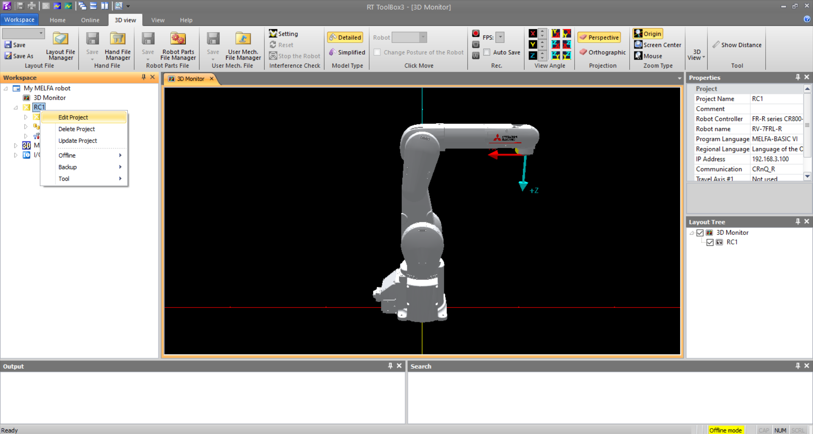
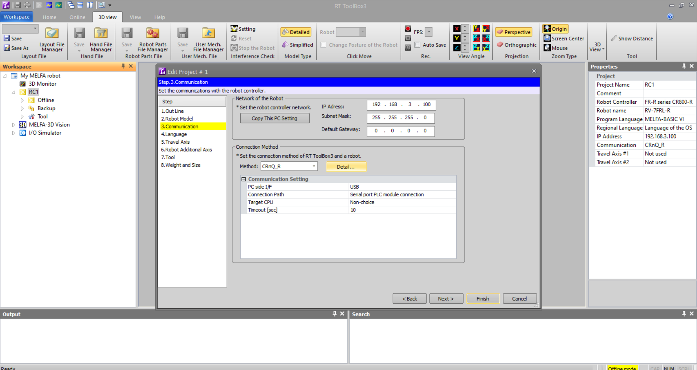
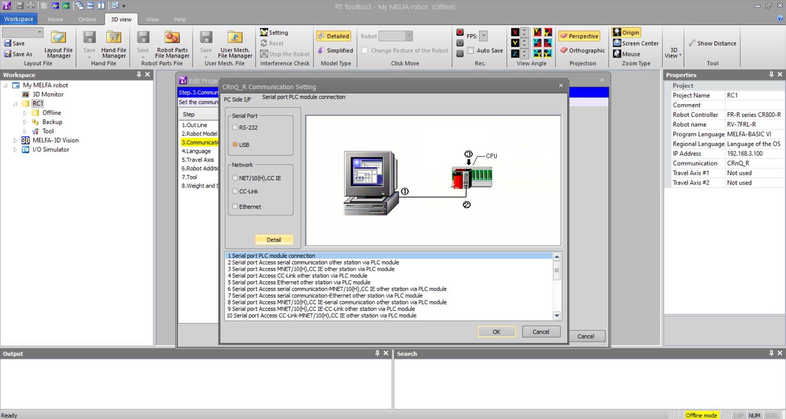
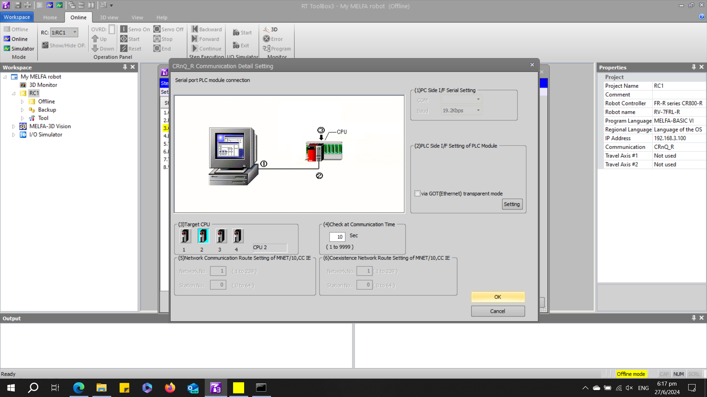
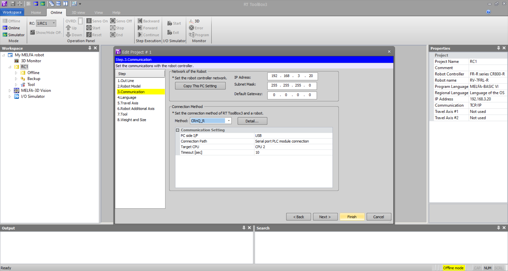
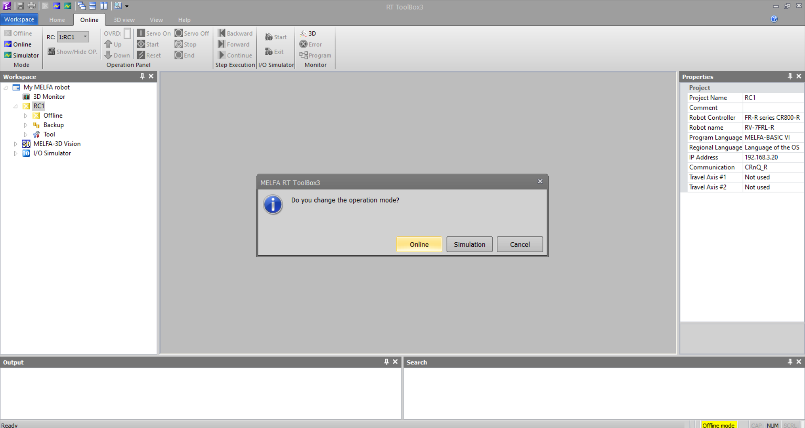
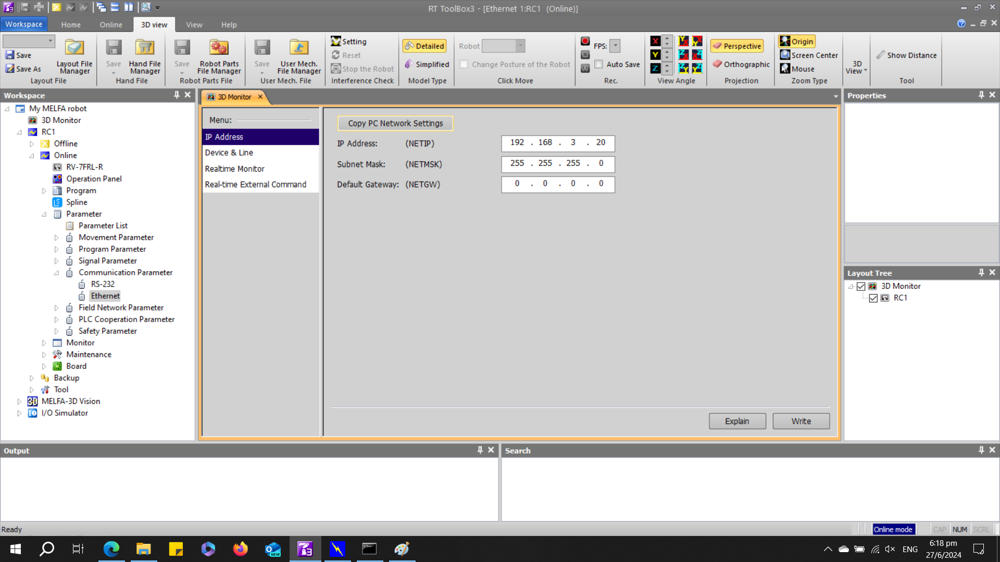
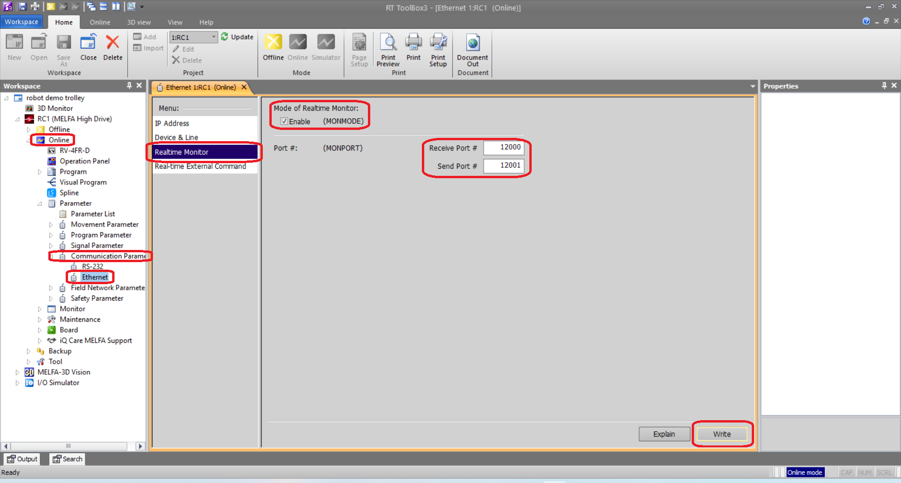
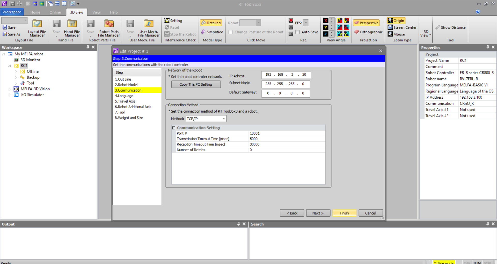
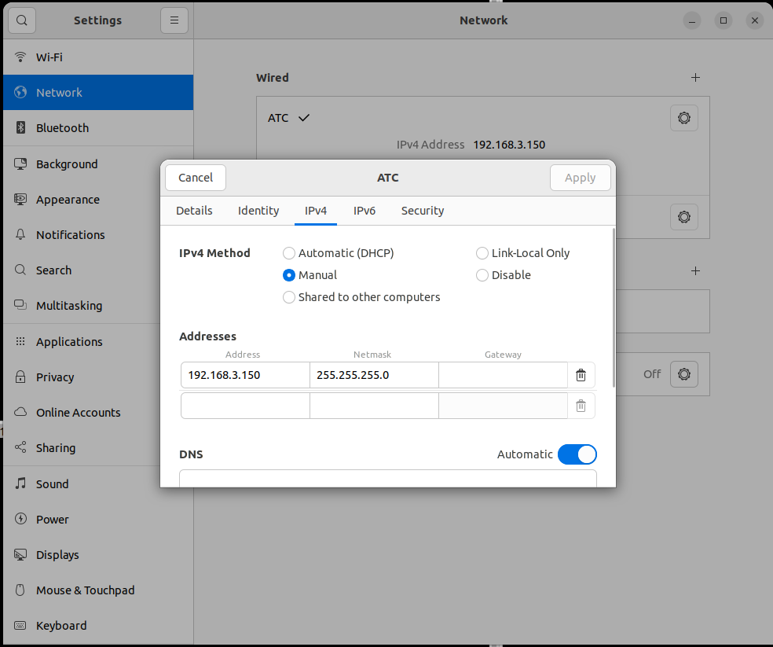

# __Connecting to Real Robot__

This section will guide you on setting up a new robot using a USB cable with ferrite core assuming that you do not know the IP address of the robot and ethernet cable assuming that you know the IP address of the robot. This section will use the RT Toolbox3 project that you have configured in Chapter __2. RT Toolbox3 Setup__ and __3. Connecting to RT Toolbox3 Simulator__ as continuation from the previous chapters. It is highly recommended to test your ROS2 application using RT Toolbox3 simulator before testing it on a physical robot.
```
Robot Factory Default IP address: 192.168.0.20
```

Sections:

1. __Connecting via USB Cable__

2. __Connecting via Ethernet Cable__

3. __Setup Real Robot__

4. __Verifying Local IP address on Ubuntu 22.04LTS__

5. __ROS2 Connection to Real Robot__

## __1. Connecting via USB Cable__

This is not the preferred way as it requires a USB cable with a ferrite core to ensure stable connection with the robot controller. If you know the IP address of the robot, please use the __Connect via Ethernet cable__ guide in the next section.

1. Ensure that RT Toolbox3 is __offline__. _Right click_ __RC1__ to open project options. Select __Edit Project__.

</br>
  

</br>

2. Select __Communication__ and set __Method:__ as __CRnQ_R__. If you are using a __CR800-D__ robot controller, set __Method:__ as __USB__ and skip to step 5. If not, Select __Detail...__

</br>
  

</br>

3. Select __Detail__

</br>
  

</br>

4. Select the __Target CPU__. For this tutorial, my robot CPU is the second CPU on the PLC. Select __OK__.

</br>
  

</br>

5. Select the __Finish__.

</br>
  

</br>

6. Select the __Online__.

</br>
  

</br>

7. On the __Workspace__ panel on the left, expand __Online__ &rArr; __Parameter__ &rArr; __Communication Parameter__ &rArr; __Ethernet__. You will find the IP address of your robot in the popup window.

</br>
  

</br>

8. Select __Realtime Monitor__, ensure that __MONMODE__ is checked. Input port numbers for __Receive Port__ and __Send Port__ as shown in the images below.

</br>
  

</br>


## __2. Connecting via Ethernet Cable__

For connection guide, refer to [CR750/CR751 Series Controller, CR800 Series Controller Ethernet Function Instruction Manual](https://www.mitsubishielectric.com/fa/download/search.page?mode=manual&kisyu=/robot&q=CR750%2FCR751%20Series%20Controller%2C%20CR800%20Series%20Controller%20Ethernet%20Function%20Instruction%20Manual&sort=0&style=0&lang=2&category1=0&filter_discontinued=0&filter_bundled=0) from [Robot Industrial/Collaborative Robot MELFA Manual](https://www.mitsubishielectric.com/fa/download/search.page?mode=manual&kisyu=/robot).

1. Ensure that RT Toolbox3 is __offline__. _Right click_ __RC1__ to open project options. Select __Edit Project__.

</br>
  

</br>

2. Select __Communication__ and set __Method:__ as TCP/IP. Select __Finish__.

</br>
  

</br>

3. Select __Online__.

</br>
  

</br>

4. Once connected to the robot, select __Online__ &rArr; __Communication Parameter__ &rArr; __Ethernet__. In the new window, select __Realtime Monitor__, ensure that __MONMODE__ is checked. Input port numbers for __Receive Port__ and __Send Port__ as shown in the images below.

</br>
  

</br>

Refer to [CR750/CR751 Series Controller, CR800 Series Controller Ethernet Function Instruction Manual](https://www.mitsubishielectric.com/fa/download/search.page?mode=manual&kisyu=/robot&q=CR750%2FCR751%20Series%20Controller%2C%20CR800%20Series%20Controller%20Ethernet%20Function%20Instruction%20Manual&sort=0&style=0&lang=2&category1=0&filter_discontinued=0&filter_bundled=0) from [Robot Industrial/Collaborative Robot MELFA Manual](https://www.mitsubishielectric.com/fa/download/search.page?mode=manual&kisyu=/robot) to setup __Real Time Monitoring Function__

## __4. Verifying Local IP address on Ubuntu 22.04LTS__

This section will guide you to find your local IP address on your Ubuntu 22.04LTS device. The process is similar on other Ubuntu versions.

1. Go to __Settings__ &rArr; __Network__ &rArr; __Wired (+)__ to create a new ethernet profile. Under __IPv4 Method__, select __Manual__ and input your preferred IP address for your Linux computer.
</br>

   

</br>

2. From your Linux computer, ping the robot's IP address. If ping is unsuccessful, verify your Linux and Robot IP addresses and try again.

~~~
#ping <Robot local IP address>
ping 192.168.3.20
~~~

## __5. ROS2 Connection to Real Robot__

Assuming that ping is successful, you are now ready to connect your robot. Connect your Linux machine to the robot via ethernet cable. For connection guide, refer to [CR750/CR751 Series Controller, CR800 Series Controller Ethernet Function Instruction Manual](https://www.mitsubishielectric.com/fa/download/search.page?mode=manual&kisyu=/robot&q=CR750%2FCR751%20Series%20Controller%2C%20CR800%20Series%20Controller%20Ethernet%20Function%20Instruction%20Manual&sort=0&style=0&lang=2&category1=0&filter_discontinued=0&filter_bundled=0) from [Robot Industrial/Collaborative Robot MELFA Manual](https://www.mitsubishielectric.com/fa/download/search.page?mode=manual&kisyu=/robot). For the purpose of this tutorial, run the following command in the terminal. 

1. This command will launch the bringup launch file for RV7FRL robot using the CR800-R robot controller. [Terminal 1]

~~~
ros2 launch melfa_mon_bringup mon_control.launch.py controller_type:="R" robot_ip:=192.168.3.100
~~~


### Other guides:
- [Home page](./../README.md)
- [MELFA ROS2 user guide](./melfa_ros2_monitor.md) : Usage and Installation of MELFA ROS2.
- [RT Toolbox3 Setup](./rt_toolbox3_setup.md) : Create your first RT Toolbox3 Project File for ROS2.
- [RT Toolbox3 Simulator Setup](./rt_sim_setup.md) : Connect to RT Toolbox3 simulator as if it is a real robot.
- [RT Toolbox3 Real Robot Setup](./rt_real_setup.md): Connect to a MELFA robot.