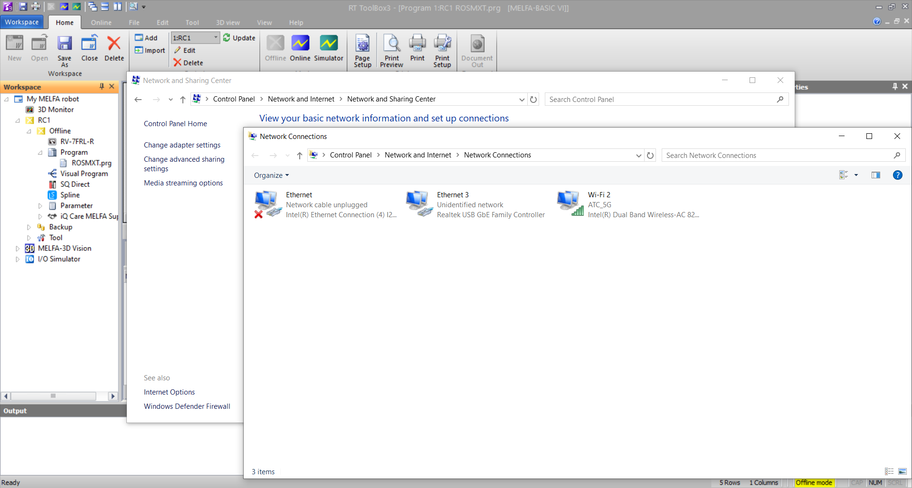
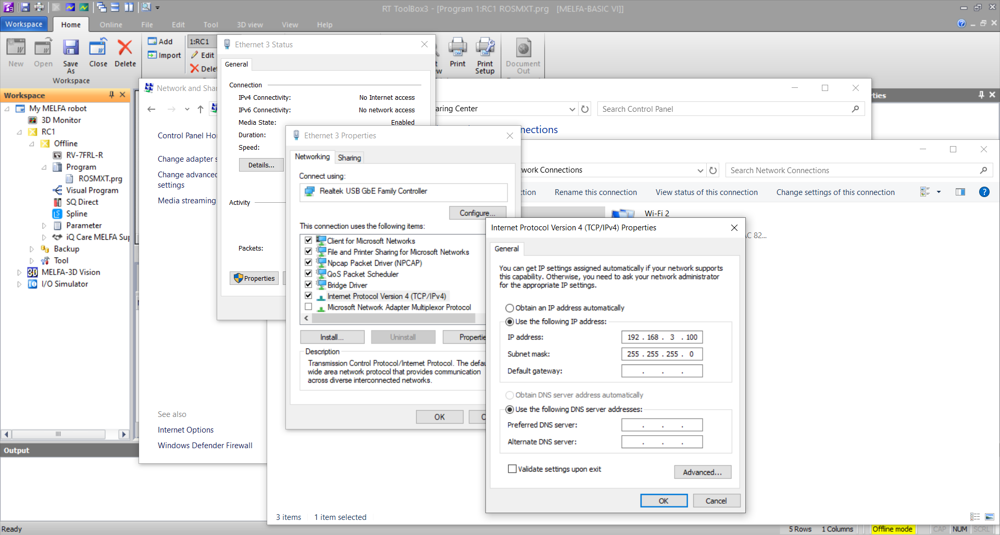
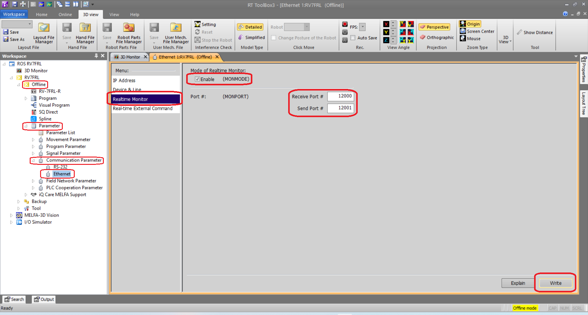
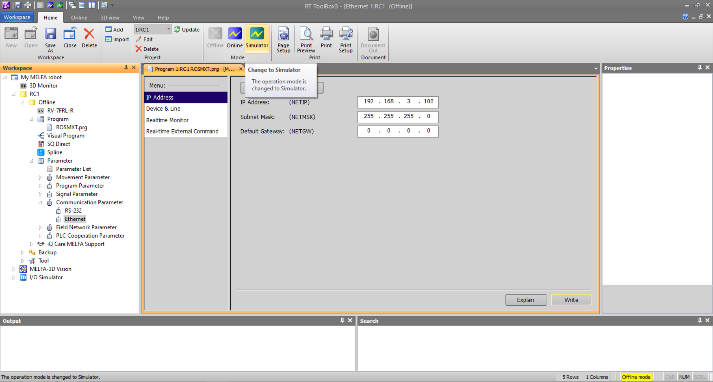

# __Connecting to RT ToolBox3 Simulator__

This section will guide you to establish a UDP/IP connection between your ROS 2 computer and _RT ToolBox3 simulator_. It is highly recommended to test your ROS 2 applications on __RT ToolBox3 simulator__ before testing it on a real robot. This is helpful as __RT ToolBox3 simulator__ provides "near real" experience with 1-to-1 error conditions, velocity profiles and close to actual cycle times.

Sections:

1. __Verifying Local IP Address on Windows__
2. __Verifying Local IP Address on Ubuntu 22.04 LTS__
3. __ROS 2 Connection to Simulator__

## __1. Verify Local IP Address on Windows__

This section will guide you to find your local IP address on your Windows10 device.

1. Go to __control panel__ &rArr; __Network and Internet__ &rArr; __Network and Sharing Centre__ and select __Change adapter settings__. Your Network adapters will be displayed in a popup window.

</br>



</br>

2. Select your network adapter that you wish to connect to your ROS 2 computer. Select __Properties__ &rArr; __Internet Protocol Version 4 (TCP/IPv4)__. In the popup window, you can change your IP to your preferred IP address in your local network.

</br>



</br>

3. Ensure that RT ToolBox3 is __offline__. Select __offline__ -> __Parameter__ -> __Communication Parameter__. Double click on __Ethernet__. In the new window, select __Realtime Monitor__, ensure that MONMODE is checked. Input the port numbers  as shown in the image.

</br>
  

</br>

4. Select __Simulator__ to launch __RT ToolBox3 simulator__.

</br>



</br>

## __2. Verifying Local IP address on Ubuntu 22.04LTS__

This section will guide you to find your local IP address on your Ubuntu 22.04 LTS device. The process is similar on other Ubuntu versions.

1. Go to __Settings__ &rArr; __Network__ &rArr; __Wired (+)__ to create a new Ethernet profile. Under __IPv4 Method__, select __Manual__ and input your preferred IP address for your Linux computer.
   
   </br>
   
    

</br>

2. From your Windows computer, ping your Linux computer. You may not be able to ping your Windows computer from your Linux computer due to Windows settings. If ping is unsuccessful, verify your Windows and Linux IP addresses and try again.

```
#ping <Linux local IP address>
# Example:
ping 192.168.3.150
```

## __3. ROS 2 Connection to Simulator__

1. Assuming that ping is successful, you are now ready to connect your RT ToolBox3 simulator as if it is a _real_ robot. For the purpose of this tutorial, run the following command in the terminal. This command will launch the bringup launch file for RV7-FRL robot using the CR800-R robot controller.

The command argument "packet_lost_log:=0" turns off the warning message for packet losses. It is highly recommended to NOT turn it off when connecting to a real robot. However, connecting to a simulation is fine.

```
ros2 launch melfa_mon_bringup monitor_control.launch.py controller_type:="R" robot_ip:=192.168.3.100 packet_lost_log:=0
```

### Other guides:

1. Install and configure MELFA ROS2 Monitor.
   
   - [MELFA ROS2 Monitor user guide](./doc/melfa_ros2_monitor.md) : Usage and Installation of MELFA ROS2 Monitor.

2. Create an RT Toolbox3 project. 
   
   - [RT ToolBox3 Setup](./doc/rt_toolbox3_setup.md) : Create your first RT ToolBox3 Project File for MELFA ROS2 Monitor.

3. Choose your development environment.
   
   - [RT ToolBox3 Simulator Setup](./doc/rt_sim_setup.md) : Connect to RT ToolBox3 simulator in place of real robots for MELFA ROS2 Monitor.   
   
   - [RT ToolBox3 Real Robot Setup](./doc/rt_real_setup.md): Connect to a MELFA robot for MELFA ROS2 Monitor.