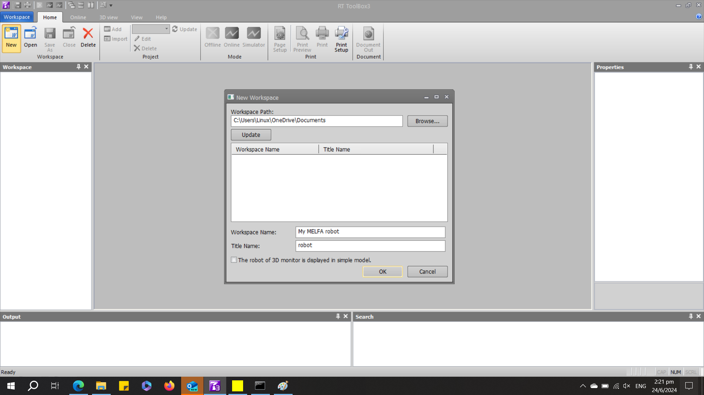
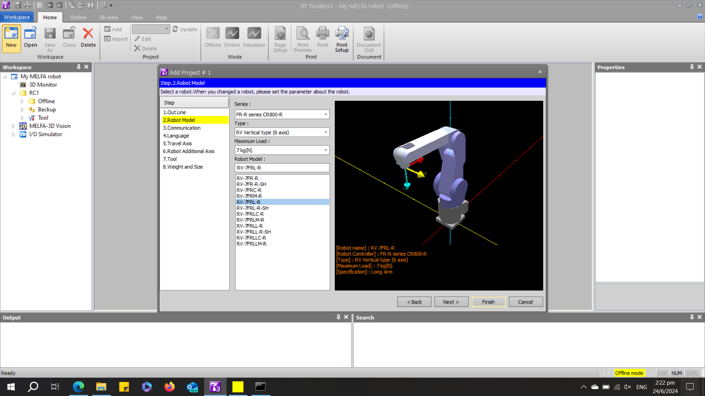
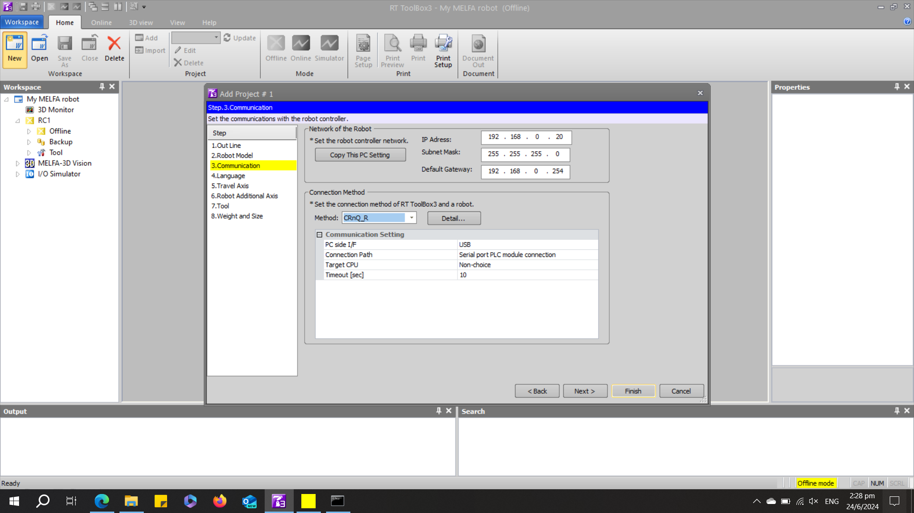
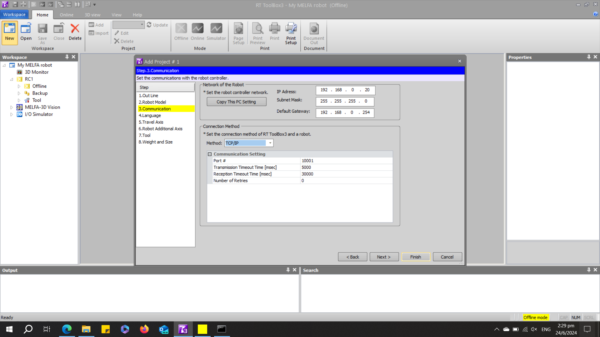
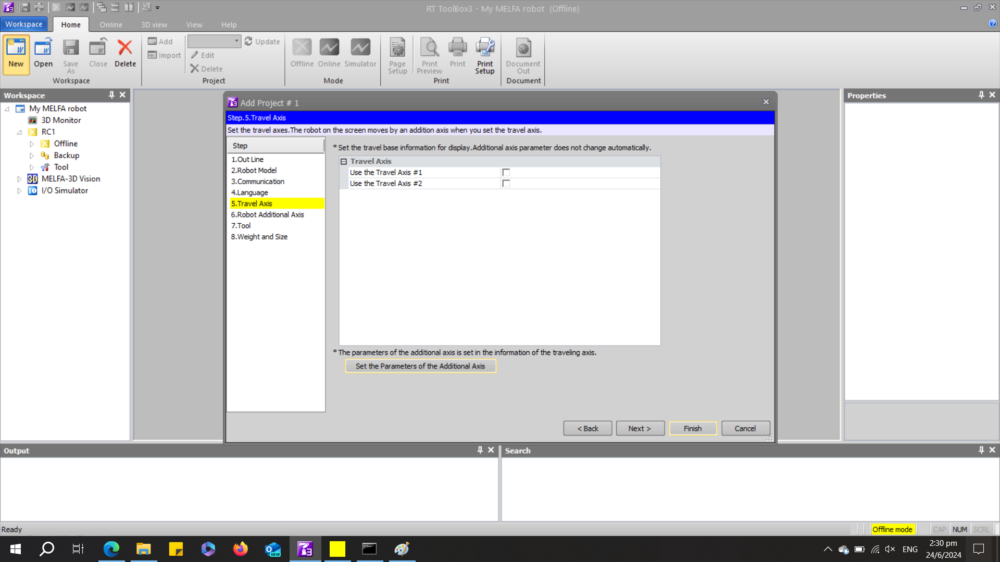
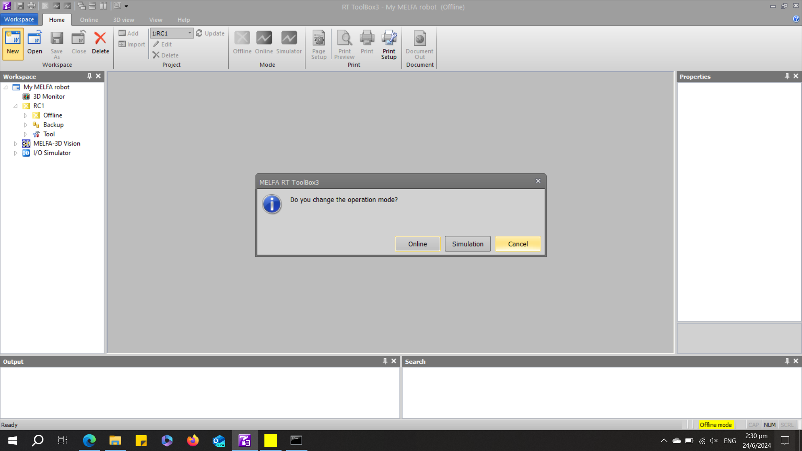

# __RT Toolbox3 Setup__

The complete RT Toolbox3 manual can be downloaded at [RT ToolBox3/RT ToolBox3 mini User's Manual](https://www.mitsubishielectric.co.jp/fa/download/search.do?mode=manual&kisyu=/robot&q=RT%20Toolbox3&sort=0&style=0&lang=2&category1=0&filter_readme=0&filter_discontinued=0&filter_bundled=0) from [Robot Industrial/Collaborative Robot MELFA Manual](https://www.mitsubishielectric.co.jp/fa/download/search.do?mode=manual&kisyu=/robot). MELFA ROS2 Driver is developed using the __Real Time External Control__ function. For more information, refer to [Ethernet Function Instruction Manual](https://www.mitsubishielectric.co.jp/fa/download/search.do?mode=manual&kisyu=/robot&q=Ethernet%20Function%20Instruction%20Manual&sort=0&style=0&lang=2&category1=0&filter_readme=0&filter_discontinued=0&filter_bundled=0) from [Robot Industrial/Collaborative Robot MELFA Manual](https://www.mitsubishielectric.co.jp/fa/download/search.do?mode=manual&kisyu=/robot)This chapter will cover the basics of project file creation, setting up a robot in simulation and connecting to a physical robot in the context of operating MELFA ROS2.

If you have completed this guide, please take a look at [real robot setup](./rt_real_setup.md) or [RT Toolbox3 simulator setup](./rt_sim_setup.md). 

Sections:
1. __Project File Setup__
2. __Program Creation__

## __1. Project File Setup__

This section will guide you on creating an RT Toolbox3 project file in the context of ROS2.

 1. Create a _project file_ by selecting __New__, and give your workspace a name and a title, as shown below.

 

   

 

 2. Select __Robot Model__ from the popup window and select your robot. For this tutorial, RV-7FRL-R will be used. 

 

   

 

 3. Select __Communication__ and select your preferred robot connection method.

 - For CRnQ_R USB connection, it is recommended to use a USB cable with a ferrite core such as  [GT09-C30USB-5P](https://mitsubishi-electric-eshop.mee.com/mee/FA_IA/en/EUR/Catalogue/HMI/Cable/GT09-C30USB-5P/p/000000000000166373)
 

  

 

 - For TCP/IP connection, it is recommended to use a CAT5e or above ethernet cable, for detailed instructions, for communicating with the robot via TCP/IP, refer to [Ethernet Function Instruction Manual](https://www.mitsubishielectric.co.jp/fa/download/search.do?mode=manual&kisyu=/robot&q=Ethernet%20Function%20Instruction%20Manual&sort=0&style=0&lang=2&category1=0&filter_readme=0&filter_discontinued=0&filter_bundled=0) from [Robot Industrial/Collaborative Robot MELFA Manual](https://www.mitsubishielectric.co.jp/fa/download/search.do?mode=manual&kisyu=/robot)

  

 4. Select __Travel Axis__ to configure robot travel axis. For this tutorial, the travel axis will not be used. To learn more about setting up the travel axis, refer to [RT ToolBox3/RT ToolBox3 mini User's Manual](https://www.mitsubishielectric.co.jp/fa/download/search.do?mode=manual&kisyu=/robot&q=RT%20Toolbox3&sort=0&style=0&lang=2&category1=0&filter_readme=0&filter_discontinued=0&filter_bundled=0) from [Robot Industrial/Collaborative Robot MELFA Manual](https://www.mitsubishielectric.co.jp/fa/download/search.do?mode=manual&kisyu=/robot). 

 -  Select __Finish__.

 

 

 5. Select __Cancel__

 

 

### Your project file is ready!
You are ready to move on to a [real robot setup](./rt_real_setup.md) or a [RT Toolbox3 simulator setup](./rt_sim_setup.md)

### Other guides:
- [Home page](./../README.md)
- [MELFA ROS2 user guide](./melfa_ros2_driver.md) : Usage and Installation of MELFA ROS2.
- [RT Toolbox3 Setup](./rt_toolbox3_setup.md) : Create your first RT Toolbox3 Project File for ROS2.
- [RT Toolbox3 Simulator Setup](./rt_sim_setup.md) : Connect to RT Toolbox3 simulator as if it is a real robot.
- [RT Toolbox3 Real Robot Setup](./rt_real_setup.md): Connect to a MELFA robot.